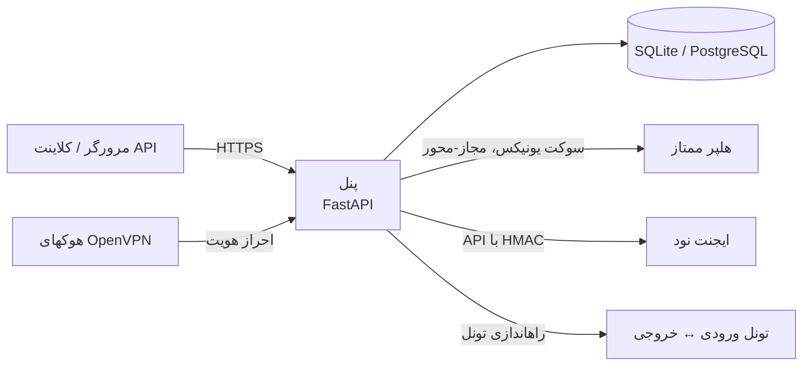

<div align="center" dir="rtl">


# نام پروژه

**مدیریت خودمیزبان VPN و تونل — OpenVPN، WireGuard، AnyConnect، L2TP/IPsec و sing-box، همراه با چند-نودی، نمایندگان (Reseller) و REST API.**

[](LICENSE)
[](https://github.com/<org>/<repo>/releases)
[](https://github.com/<org>/<repo>/actions/workflows/ci.yml)

[English](README.md) | **فارسی**

</div>

<div dir="rtl">

> **توجه حقوقی.** این نرمافزار «همانگونه که هست» و تحت پروانه MIT و **بدون هیچ
> ضمانتی** ارائه میشود و تنها برای **استفاده قانونی** در نظر گرفته شده است. شما
> بهتنهایی مسئول رعایت قوانین و شرایط ارائهدهندهٔ میزبانی در کشور محل قرارگیری
> سرور و محل استفادهٔ آن هستید. نویسندگان در قبال سوءاستفاده مسئولیتی ندارند.
> ابزارهای ثالث که هنگام نصب دانلود میشوند تابع پروانهٔ خودشان هستند —
> [`THIRD_PARTY_LICENSES.md`](THIRD_PARTY_LICENSES.md) و
> [`docs/RESPONSIBLE_USE.md`](docs/RESPONSIBLE_USE.md).

## نصب با یک خط فرمان

روی یک سرور **تازهٔ** اوبونتو ۲۲.۰۴ یا ۲۴.۰۴ (آزمایششده روی Debian 12 نیز):

```bash
bash <(curl -fsSL https://github.com/<org>/<repo>/releases/latest/download/install.sh)
```

نصبکننده نسخهٔ **برگشتیِ تگشده** را دانلود میکند (هرگز از شاخهٔ `main`)،
SHA256 آن را بررسی میکند، همهٔ پیشنیازها را نصب میکند و نشانی پنل و اطلاعات
ورود را نمایش میدهد. هیچ چیز نباید از قبل نصب شده باشد — نه `git` و نه Node.js.

سیستمعاملهای پشتیبانیشده: **اوبونتو ۲۲.۰۴ / ۲۴.۰۴**، Debian 12.
حداقل منابع: **۱ هسته، ۵۱۲ مگابایت رم، ۲ گیگابایت دیسک**.

## تصاویر

> تصاویر خود را در `docs/screenshots/` قرار دهید (با دادههای ساختگی از طریق
> `scripts/seed_demo.py`) و اینجا ارجاع دهید. نمونه: ``.

## ویژگیها

| بخش | امکانات |
| --- | --- |
| **پروتکلها** | OpenVPN (UDP/TCP)، WireGuard، Cisco AnyConnect (ocserv)، L2TP/IPsec و sing-box |
| **کاربران و محدودیتها** | سهمیهٔ داده، تاریخ انقضا، محدودیت سرعت، حداکثر اتصال همزمان، دسترسی هر کاربر به نودها |
| **نمایندگان (Reseller)** | زیرمدیرها با محدودیت کاربر، سهمیه، انقضا و فهرست مجاز نودها (اجرا در سمت سرور) |
| **چند-نودی** | ایجنت سبک با امضای HMAC، سلامت و متریکها، ویرایشگر تنظیمات هر نود، صف تلاش مجدد |
| **تونلها** | فوروارد ورودی↔خروجی (Backhaul / WireGuard / sing-box) با ویزارد، یابندهٔ MTU و بازیابی خودکار |
| **API** | REST نسخهدار زیر `/api/v1` با کلیدهای محدودهدارِ هششده؛ مستندات در `/api/docs` |
| **پشتیبانگیری** | آرشیو رمزنگاریشده (دیتابیس + تنظیمات + PKI) با زمانبندی و آپلود به تلگرام/وبهوک |
| **SSL** | Let's Encrypt یا بارگذاری گواهی دستی |
| **رابط کاربری** | Jinja2 و HTMX، تم روشن/تاریک، دو زبان انگلیسی و فارسی (RTL) |
| **امنیت** | argon2id، نشست سمت سرور، CSRF، محدودیت نرخ ورود، کوکی امن، هلپر مجاز-محور |

بهعلاوه: ویرایشگر تنظیمات سرور با اعتبارسنجی و بازگردانی، صفحهٔ اشتراک هر کاربر
(`/sub/<token>`) با QR، اعلانها، SQLite بهصورت پیشفرض و PostgreSQL اختیاری.

**بدون تلمتری، بدون کلید لایسنس، بدون فعالسازی و بدون نسخهٔ «پرو».** بررسی
بهروزرسانی اختیاری و بهصورت پیشفرض خاموش است.

## شروع سریع

```bash
# ۱) نصب (یک خط فرمان بالا)، سپس خواندن فایل اطلاعات ورود:
sudo cat /root/<slug>-install-info.txt
# ۲) باز کردن نشانی پنل، ورود و تغییر گذرواژهٔ مدیر.
# ۳) ساخت کاربر: Users → New user
# ۴) مدیریت روزمره:
sudo <slug>          # منوی تعاملی
```

راهنمای کامل در [`docs/fa/quickstart.md`](docs/fa/quickstart.md).

## معماری



## ارتقا، پشتیبانگیری، بازگردانی، حذف

```bash
sudo <slug> update                       # بهروزرسانی بدون حذف دادهها
sudo <slug> backup --output /var/backups # پشتیبان رمزنگاریشده
sudo <slug> restore <archive>            # بازگردانی
sudo <slug> uninstall [--purge]          # حذف (‏--purge دادهها را هم پاک میکند)
```

## امنیت

هش argon2id، نشست سمت سرور، توکن CSRF وابسته به نشست، محدودیت نرخ ورود بر پایهٔ
`ip:username`، کوکیهای `Secure`/`HttpOnly`/`SameSite` و هدرهای امنیتی؛ عملیات
ممتاز محدود به هلپر مجاز-محور؛ بدون ساخت دستور پوسته؛ فراخوانیهای HMAC؛
پشتیبان رمزنگاریشده؛ کلیدهای API فقط بهشکل هش. برای جزئیات
[`SECURITY.md`](SECURITY.md) و [مدل تهدید](docs/THREAT_MODEL.md) را ببینید.

## مستندات

- [شروع سریع](docs/fa/quickstart.md) · [نصب](docs/fa/installation.md) · [CLI](docs/fa/CLI.md)
- [معماری](docs/architecture.md) · [چند-نودی](docs/multi-node.md) · [تونلها](docs/TUNNEL.md)
- [پروتکلها](docs/protocols.md) · [REST API](docs/api.md) · [پشتیبانگیری](docs/backup.md)
- [رفع اشکال](docs/troubleshooting.md) · [انتشار](docs/RELEASING.md) · [نقشهٔ راه](docs/ROADMAP.md)
- [استفادهٔ مسئولانه](docs/fa/responsible-use.md) · [پروانههای ثالث](THIRD_PARTY_LICENSES.md)

## پرسشهای متداول

**آیا به PostgreSQL نیاز دارم؟** نه؛ SQLite پیشفرض است. با
`<slug> migrate-db --target postgresql+psycopg://...` جابهجا شوید.

**گذرواژهها کجا ذخیره میشوند؟** تنها هش argon2id؛ احراز هویت OpenVPN از طریق
سوکت یونیکس محلی انجام میشود.

**آیا نماینده میتواند کاربران سایر نمایندگان را ببیند؟** نه؛ دسترسی در هر درخواست
در سمت سرور محدود میشود.

**آیا تلمتری یا لایسنس وجود دارد؟** نه؛ بررسی بهروزرسانی اختیاری است و هیچ
دادهای ارسال نمیشود.

## مشارکت و پشتیبانی

[`CONTRIBUTING.md`](CONTRIBUTING.md) و [آییننامهٔ رفتار](CODE_OF_CONDUCT.md).
گزارش امنیتی: [`SECURITY.md`](SECURITY.md). کمک مالی اختیاری است و هیچ قابلیتی
را باز نمیکند.

## پروانه

[MIT](LICENSE). فهرست کامل وابستگیها و باینریهای دانلودی در
[`THIRD_PARTY_LICENSES.md`](THIRD_PARTY_LICENSES.md).

</div>
