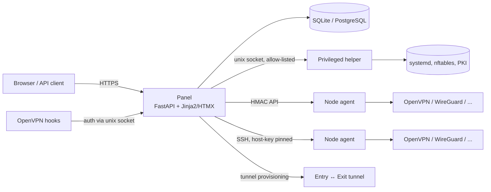

<div align="center">


# Project Name

**Self-hosted VPN & tunnel management — OpenVPN, WireGuard, AnyConnect, L2TP/IPsec and sing-box, with multi-node, resellers and a REST API.**

[](LICENSE)
[](https://github.com/soheil-asgari/openvpn_panel/releases)
[](https://github.com/soheil-asgari/openvpn_panel/actions/workflows/ci.yml)
[](https://github.com/soheil-asgari/openvpn_panel/stargazers)

**English** | [فارسی](README.fa.md)

</div>

> **Legal notice.** This software is provided **"as is"** under the MIT license,
> **without warranty of any kind**, and is intended for **lawful use only**. You
> are solely responsible for complying with the laws and the hosting provider's
> terms in the country where the server is located and where it is used. The
> authors are not responsible for misuse. Third-party tools downloaded at install
> time are governed by their own licenses — see
> [`THIRD_PARTY_LICENSES.md`](THIRD_PARTY_LICENSES.md) and
> [`docs/RESPONSIBLE_USE.md`](docs/RESPONSIBLE_USE.md).

## One-line install

On a **fresh** Ubuntu 22.04 / 24.04 server (also tested on Debian 12):

```bash
bash <(curl -fsSL https://github.com/soheil-asgari/openvpn_panel/releases/latest/download/install.sh)
```

The installer downloads the **pinned, tagged release** (never a branch),
verifies its SHA256, installs every prerequisite, and prints your panel URL and
credentials. Nothing needs to be preinstalled — no `git`, no Node.js.

Supported OS: **Ubuntu 22.04 / 24.04**, Debian 12. Minimum: **1 vCPU, 512 MB RAM,
2 GB disk**.

## Screenshots

> Drop your own captures into `docs/screenshots/` (generated from a demo instance
> with fake data via `scripts/seed_demo.py`) and reference them here:
> ``.

| Dashboard | Users | Tunnels |
| --- | --- | --- |
| _dashboard.png_ | _users.png_ | _tunnels.png_ |

## Features

| Area | What you get |
| --- | --- |
| **Protocols** | OpenVPN (UDP/TCP), WireGuard, Cisco AnyConnect (ocserv), L2TP/IPsec (Libreswan + xl2tpd), sing-box (VMess/VLESS/Trojan/Hysteria2) |
| **Users & limits** | per-user data quota, expiry, speed limit, max-connections, per-node visibility, online view |
| **Resellers** | sub-admins with per-account limits (max users, aggregate quota, expiry, node allow-list) enforced server-side |
| **Multi-node** | lightweight HMAC-signed node agent, health/metrics, per-node config editor, offline retry queue |
| **Tunnels** | entry ↔ exit forwarding (Backhaul / WireGuard / sing-box) with a wizard, MTU finder and auto-recovery |
| **API** | versioned REST API (`/api/v1`) with scoped, revocable, hashed API keys; OpenAPI at `/api/docs` |
| **Backups** | encrypted, authenticated archives (DB + config + PKI) with scheduling and Telegram/webhook upload |
| **SSL** | Let's Encrypt or custom PEM upload for the panel |
| **UI** | Jinja2 + HTMX + Tailwind-style CSS, dark/light theme, i18n (English + Persian/RTL) |
| **Security** | argon2id, server-side sessions, CSRF, login rate limiting, secure cookies, allow-listed privileged helper |

Plus: server-config editor with validation and rollback, per-user subscription
pages (`/sub/<token>`) with QR codes, notifications (Telegram/webhook), SQLite by
default with optional PostgreSQL, and a built-in migration tool.

**No telemetry, no license keys, no activation, no "pro" tier** — by design. The
optional update check is **off by default**.

## Quick start

```bash
# 1. Install (see the one-liner above), then read the credentials file:
sudo cat /root/<slug>-install-info.txt

# 2. Open the panel URL, log in, change the admin password.

# 3. Create a user: Users → New user → copy the .ovpn and credentials.

# 4. (Optional) Add a second server: Nodes → Add node.

# 5. (Optional) Create an entry↔exit tunnel: Tunnels → New tunnel.

# 6. Manage everything afterwards:
sudo <slug>          # interactive menu
```

See [`docs/quickstart.md`](docs/quickstart.md) for the full first-run walkthrough.

## Architecture



## Upgrade, backup, restore, uninstall

```bash
sudo <slug> update                       # update, keep data
sudo <slug> backup --output /var/backups # encrypted backup
sudo <slug> restore <archive>            # restore
sudo <slug> uninstall [--purge]          # remove (--purge deletes data)
```

## Security

argon2id password hashing, server-side sessions, session-bound CSRF tokens,
per-`ip:username` login rate limiting, `Secure`/`HttpOnly`/`SameSite` cookies and
security headers; privileged operations confined to an allow-listed helper; no
shell strings; HMAC-signed panel→agent calls; encrypted backups; API keys stored
only as hashes. See [`SECURITY.md`](SECURITY.md) and the
[threat model](docs/THREAT_MODEL.md) (including what a relay/exit server can and
cannot see).

## Documentation

- [First steps](docs/quickstart.md) · [Installation](docs/installation.md) · [CLI](docs/CLI.md)
- [Architecture](docs/architecture.md) · [Multi-node](docs/multi-node.md) · [Tunnels](docs/TUNNEL.md)
- [Protocols](docs/protocols.md) · [REST API](docs/api.md) · [Backup & restore](docs/backup.md)
- [Troubleshooting](docs/troubleshooting.md) · [Releasing](docs/RELEASING.md) · [Roadmap](docs/ROADMAP.md)
- [Responsible use](docs/RESPONSIBLE_USE.md) · [Third-party licenses](THIRD_PARTY_LICENSES.md)
- Persian docs: [`docs/fa/`](docs/fa/) · [`README.fa.md`](README.fa.md)

## FAQ

**Do I need PostgreSQL?** No — SQLite is the default. Switch with
`<slug> migrate-db --target postgresql+psycopg://...`.

**Where are passwords stored?** Only argon2id hashes. OpenVPN authentication is
verified by the panel over a local unix socket.

**Can a reseller see other resellers' users?** No. Access is scoped server-side
on every request; resellers also have per-account limits and node allow-lists.

**Is there telemetry or licensing?** No telemetry, no license keys, no phone-home.
The update check is opt-in and sends no data.

**How do I back up everything?** One encrypted archive via
`<slug> backup` or **Settings → Backups** — see [`docs/backup.md`](docs/backup.md).

## Contributing & support

See [`CONTRIBUTING.md`](CONTRIBUTING.md) and the
[Code of Conduct](CODE_OF_CONDUCT.md). Security reports: [`SECURITY.md`](SECURITY.md).
Donations are optional and never unlock features.

## Layout

```
app/      Web application (api, core, models, services, templates, static, i18n)
agent/    Node agent (FastAPI, HMAC auth)
helper/   Privileged helper (unix socket, allow-listed actions)
scripts/  install/update/uninstall, CLI menu, release + verification scripts
tests/    pytest suite
docs/     Documentation (EN + FA)
```

## License

[MIT](LICENSE). See [`THIRD_PARTY_LICENSES.md`](THIRD_PARTY_LICENSES.md) for every
dependency and downloaded binary.
